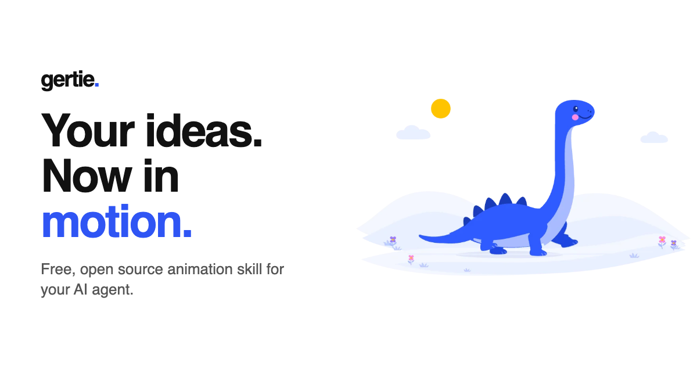

<p align="center"></p>

<p align="center">
  <a href="https://gertiestudio.pages.dev">Website</a> ·
  <a href="https://gertiestudio.pages.dev/gallery">Gallery</a> ·
  <a href="https://gertiestudio.pages.dev/docs/">Docs</a> ·
  <a href="#install">Install</a>
</p>

# Gertie

A free, open-source skill that lets any AI agent create vector animations: Lottie, animated SVG, GIF, transparent video and full MP4. No credits, no account, no network calls.

You ask your agent for an animation in plain language. The agent writes a small scene file. Gertie compiles it, checks it, renders it in a real browser, and exports the formats you need.

<p align="center"></p>

## What it makes

- Lottie JSON and `.lottie` for apps and websites
- Self-contained animated SVG that plays in an `` tag with no JavaScript, like the pulsing ring above
- GIF, transparent GIF, APNG, animated WebP
- WebM with alpha, ProRes 4444, HEVC with alpha, MP4, and direct export for Telegram, Discord, Slack, WhatsApp and more
- Multi-scene videos from a storyboard, with captions, transitions and music
- ASCII (text-character) animation
- Smooth, looping Three.js 3D scenes as standalone HTML

See them in the [gallery](https://gertiestudio.pages.dev/gallery). Each example shows the prompt that made it.

## Requirements

- Node 22 or newer. Enough to compile and validate.
- Playwright and a browser to render and run quality checks. If Google Chrome is installed, `npm install playwright` in the skill folder is enough. Otherwise also run `npx playwright install chromium` (on Linux add `--with-deps`).
- ffmpeg to export anything except `lottie`, `svg` and `lottie-zip`.

Run `node scripts/gertie.mjs doctor` inside the skill folder. It reports what is present and what is missing.

## Install

With the skills installer:

```bash
npx skills add ajithonmain/gertie
```

Or by hand. Claude Code:

```bash
git clone https://github.com/ajithonmain/gertie
cp -r gertie/skills/gertie ~/.claude/skills/
```

Codex CLI, Gemini CLI and Cursor read `.agents/skills/` (user folder `~/.agents/skills/`); Cursor also reads `.cursor/skills/` and `.claude/skills/`. Copy `skills/gertie` into the folder your agent uses.

Then check the setup:

```bash
node ~/.claude/skills/gertie/scripts/gertie.mjs doctor
```

## Use

Ask your agent: "make a loading spinner and export it as a transparent WebM". The agent reads `SKILL.md`, writes `spinner.gertie.json`, runs `qa`, looks at the contact sheet, fixes what it finds and exports.

To drive it yourself, with any scene from `examples/`:

```bash
node skills/gertie/scripts/gertie.mjs qa examples/spinner-ring.gertie.json
node skills/gertie/scripts/gertie.mjs export examples/spinner-ring.gertie.json --to gif,webm
node skills/gertie/scripts/gertie.mjs export examples/spinner-ring.gertie.json --for telegram
```

`qa` writes the Lottie JSON, the SVG and a contact sheet to `out/` next to the scene. `export` writes to `out/` too, or to `--out dir`. Run `gertie <command> --help` for a command's options.

### 3D animation

Build smooth, looping Three.js scenes with procedural shapes, lighting, adjustable materials, multi-axis rotation and floating motion. The generated HTML plays offline in a WebGL 2 browser.

```bash
node skills/gertie/scripts/gertie.mjs three build examples/three-turntable.three.json --out out/turntable.html
```

See the [Three.js scene reference](skills/gertie/references/three.md) for options.

## Which agents it works with

Tested in Claude Code and Codex CLI. Gemini CLI and Cursor read the same skill folders but have not been tested yet. Firefox rendering has not been verified. Agent pass rates and the method are on the website and in [`docs/19-agent-evaluation.md`](docs/19-agent-evaluation.md).

## Privacy and ownership

Gertie runs entirely on your machine. It makes no network requests: lottie-web and the Lottie schema are bundled and the renderer loads local files only. There is no telemetry.

Gertie claims no rights over what it produces. Animations belong to the person who made them, subject to the rights in any artwork they supplied.

## Develop

```bash
npm ci
npm run build        # typecheck, then bundle src/cli to skills/gertie/scripts
npm test             # unit and golden tests
npm run test:browser # Playwright tests
npm run build:site   # website into site/dist
node tests/eval/run.mjs --model haiku   # agent evaluation (costs tokens)
```

The design is in [`docs/`](docs/00-index.md), starting at the index. See [`CONTRIBUTING.md`](CONTRIBUTING.md). Bugs and ideas go in [issues](https://github.com/ajithonmain/gertie/issues).

## Licence

Code: MIT, see [`LICENSE`](LICENSE). Bundled third-party notices are in [`skills/gertie/assets/THIRD-PARTY-LICENSES.txt`](skills/gertie/assets/THIRD-PARTY-LICENSES.txt); the audit is in [`docs/18-licence-audit.md`](docs/18-licence-audit.md).

Gallery and website artwork remain the property of their creators and are not covered by the MIT licence unless stated.

Gertie is not affiliated with LottieFiles or the Lottie Animation Community. Lottie is an open animation format; Gertie produces files in that format.
